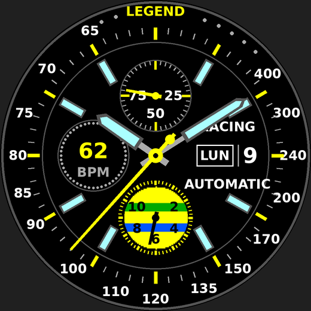

# Racing Chrono – cadran Garmin Fenix 6 Pro

Cadran de montre Connect IQ inspiré des chronographes de course jaune et noir :
lunette tachymètre, index luminescents, trotteuse jaune et compteur à bandes
jaune / vert / bleu.

| Emplacement | Affiche |
|---|---|
| Compteur de 12 h | Batterie (0–100 %, aiguille rouge sous 15 %) |
| Compteur de 9 h | Fréquence cardiaque (BPM) |
| Compteur de 6 h | Pas (aiguille de 0 à 12 000, graduations 2…10 = milliers) |
| Côté 3 h | Jour de la semaine + date |
| Trotteuse jaune | Visible quand tu lèves le poignet (mode éveillé) |

Les textes `LEGEND`, `RACING` et `AUTOMATIC` se changent dans
`resources/strings/strings.xml` (mets ton prénom, par exemple).

## Compiler et installer

1. Installer **Visual Studio Code** et l'extension **Monkey C** (Garmin).
2. Installer le **Connect IQ SDK Manager**, se connecter avec son compte Garmin,
   télécharger le dernier SDK et le périphérique **fēnix® 6 Pro**.
3. Dans VS Code : `Ctrl+Shift+P` → *Monkey C: Generate a Developer Key* (une seule fois).
4. Ouvrir le dossier `RacingChrono`, puis `Ctrl+Shift+P` → *Monkey C: Build for Device*
   → choisir `fenix6pro`. On obtient un fichier `RacingChrono.prg`.
   (Pour tester avant : *Monkey C: Run* lance le simulateur.)
5. Brancher la montre en USB et copier le `.prg` dans le dossier `GARMIN/APPS/`.
6. Débrancher, puis sur la montre : appui long sur **MENU** → *Cadran de montre* →
   choisir **Racing Chrono**.

`tools/preview.py` régénère l'aperçu et l'icône : `python3 tools/preview.py preview.png resources/drawables/launcher_icon.png`.
